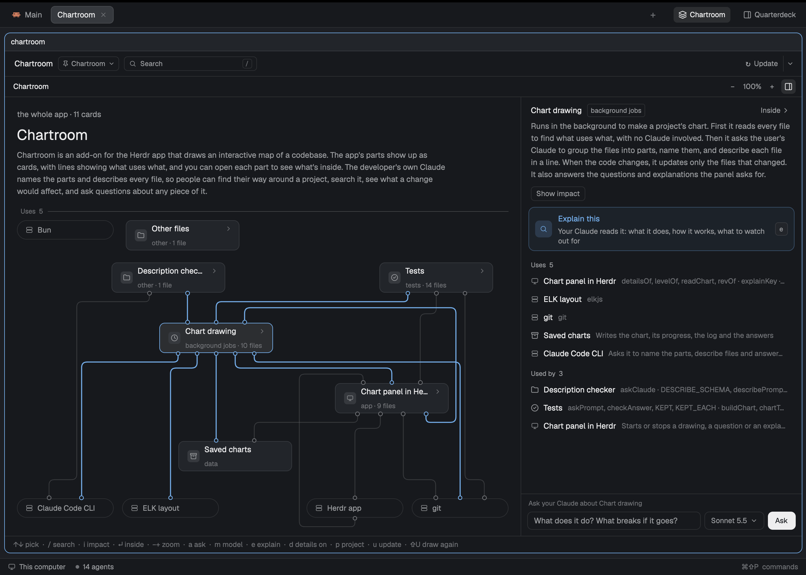
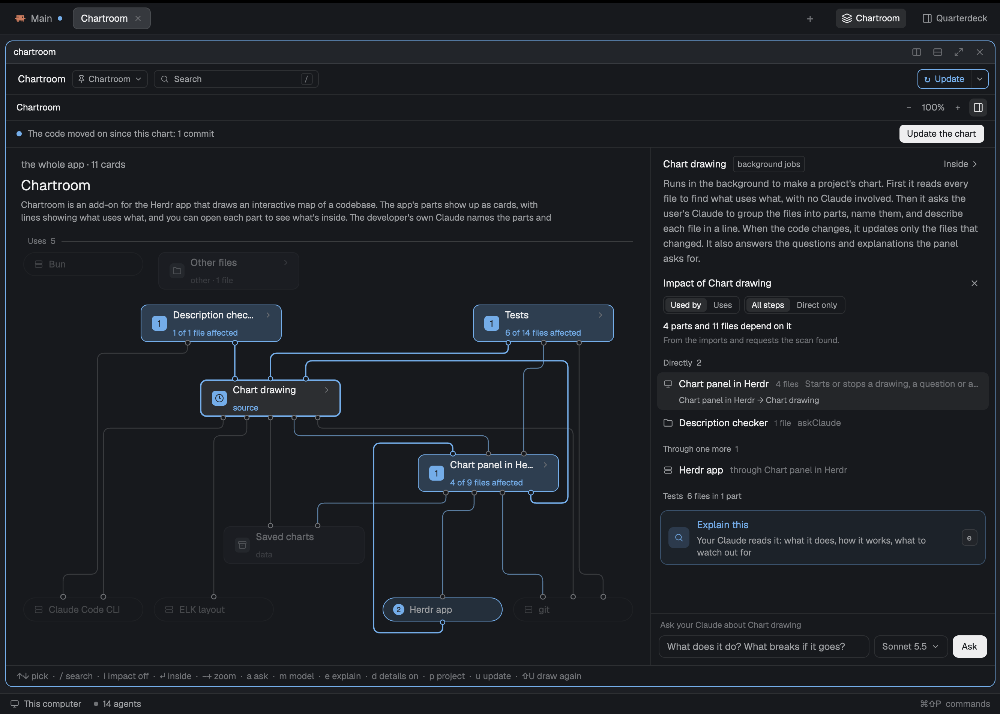
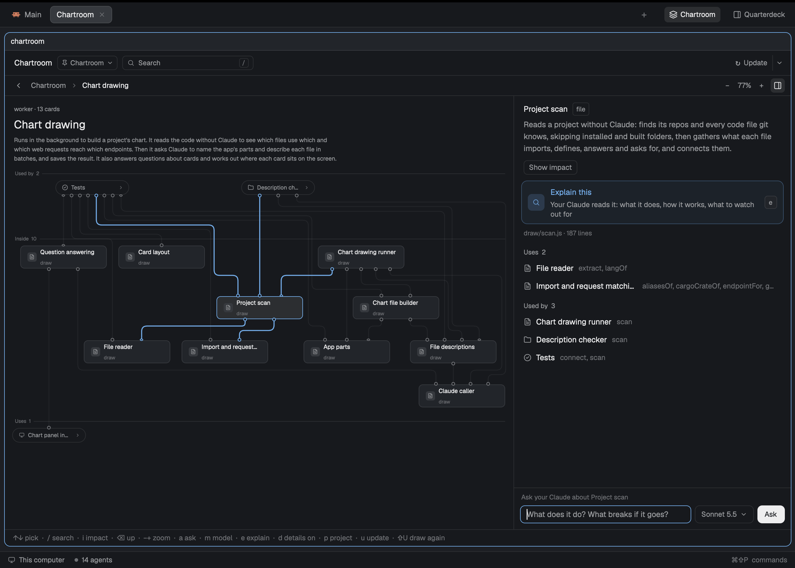

# Chartroom

[](https://github.com/PieterLuypaert/chartroom/actions/workflows/test.yml)

Chartroom is an add-on for the [Herdr app](https://herdr.dev) that draws an interactive map of a codebase. The app's parts show up as cards, with lines showing what uses what, and you can open each part to see what's inside. The developer's own Claude names the parts and describes every file, so people can find their way around a project, search it, see what a change would affect, and ask questions about any piece of it.



**Impact** shows what a change to a part or file can reach. Pick a card and press `i`: every card that depends on it lights up, marked with how many steps away it is, and the rest dims. The details count the parts and files, group them by step, and show the chain back to the card picked. **Uses** turns the question around, to what the card relies on, and **Direct only** keeps what is one step away. It comes straight from the imports and requests in the code, without Claude, so it is instant.

Here, everything that depends on Chart drawing: the panel and the Description checker use it directly, the Herdr app through the panel, and six of the tests:



Go inside a part to see its files:



## Features

| Feature | What you get |
|---|---|
| **Explore** | Each level in three bands: what uses a part, what is inside it, what it uses. Lines show what uses what. Double-click a card to go inside, scroll to zoom, drag to move. |
| **Find** | Go straight to a part or file by its name, a path, or a route such as `GET /orders`. |
| **Impact** | Everything that depends on the card picked, any number of steps away, lit on the chart. The details group it by step and show the chain back to it. No Claude needed, so it is instant. |
| **Explain** | Your Claude explains any card: what it does and how it fits in. |
| **Ask** | Ask about a card or a level, and see the cards in the answer lit on the chart. Pick the model it is asked on. |
| **Stay current** | The panel sees when the code moves on. An update re-describes only the files that changed, and keeps the explanations of the rest. |
| **Draw again** | The parts named anew and every file described again. It says the files, calls and time first, and the chart stays until the new one is done. |
| **Details** | What a card or level holds, beside the chart or under it. Drag their edge to resize them, or fold them away. |
| **Fits in** | Follows the focused space or any project you pick, full size in a tab or as a side panel, in your Herdr theme's colors. |

## Install

Needs the Herdr app, [Bun](https://bun.sh), `git`, `jq` and the Claude Code CLI, logged in.

**With your agent.** Paste this into Claude Code, or another agent on your computer:

```text
Read ~/.config/herdr-app/AGENTS.md, then add this mod: https://github.com/PieterLuypaert/chartroom
It draws with the scripts beside it in the repo, so clone the whole repo to a folder that stays and run its ./install.sh instead of copying the mod folder.
```

**By hand.**

```sh
git clone https://github.com/PieterLuypaert/chartroom.git
cd chartroom
./install.sh
```

Run it with the Herdr app open. It links the mod, binds its keys and adds a **Chartroom** button to your layout's tab bar. Herdr replaces its own layouts on every start, so when one of those is shown, `install.sh` puts the Chartroom into a copy of it, such as `main-chart`, and shows that. After pulling, run `./install.sh` again and restart Herdr.

Then click **Chartroom** or press `⌥⌘F`; `⌥⇧⌘F` opens it as a side panel. In a project without a chart, click **Draw the chart**.

## How it works

Drawing has two halves. **Without Claude**, a scan reads every file and finds what it imports (JavaScript, TypeScript, Python, Go, PHP, Java, Kotlin, Rust) and which web requests reach which endpoints: those are the chart's lines. **Your Claude** then groups the files into the app's parts and names them, in one read-only `claude -p` call, and describes every file in a line, in batches on a faster model. The chart is written to `.chartroom/` in the project, kept out of git.

Everything runs locally, on your own Claude subscription. Claude only gets tools that read: it never changes your code.

Every code file is charted, however large the project.

## Development

```sh
bun test                          # unit and end-to-end tests, no Claude or Herdr needed
herdr-app check mods/chartroom    # load the mod once
bun scripts/check-descriptions.js --compare <folder>   # how true a chart's descriptions are, judged by Opus (uses your Claude)
bun draw/draw.js <folder>         # draw a chart from the command line
```

`draw/` holds the drawing, `mods/chartroom/` the panel. [RECIPE.md](RECIPE.md) describes the Chartroom for an agent to build from an empty folder.

## License

[MIT](LICENSE)
