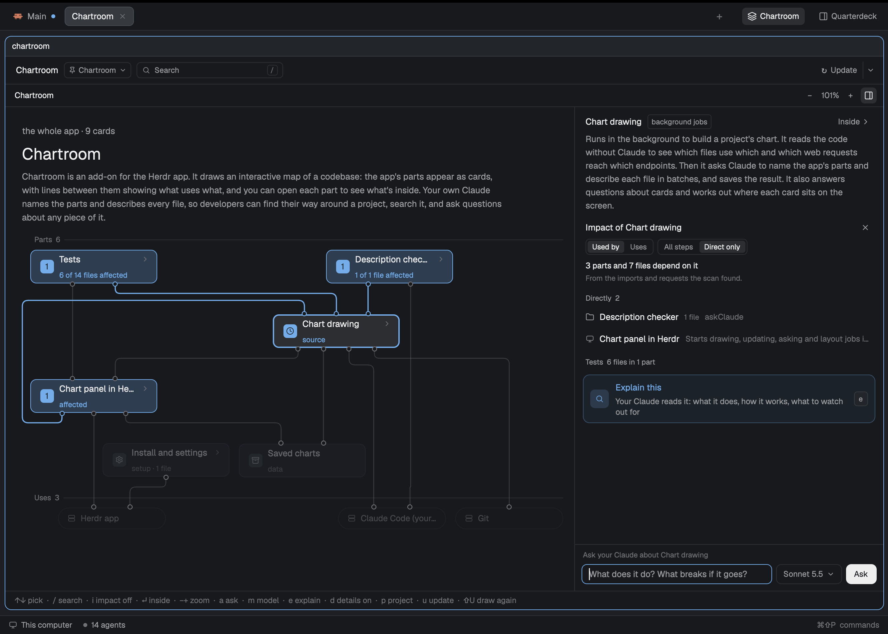

# Chartroom

[](https://github.com/PieterLuypaert/chartroom/actions/workflows/test.yml)

An interactive map of your codebase in the [Herdr app](https://herdr.dev), drawn by your own Claude.

The Chartroom reads a project, asks `claude` to name its parts and describe every file, and shows the result as a chart you can explore: the app's parts as cards, what uses what as lines, one level at a time.


Press `i` to see what depends on the card picked:



Go inside a part to see its files:


## Features

| Feature | What you get | How |
|---|---|---|
| **Explore** | Each level in three bands: what uses a part, what is inside it, what it uses. Lines show what uses what. | Double-click or `↵` to go inside, `⌫` to go up; scroll to zoom, drag to move |
| **Find** | Go straight to a part or file by its name, a path, or a route such as `GET /orders`. | `/` or the search box |
| **Impact** | Everything that depends on the card picked, any number of steps away, lit on the chart. The details group it by step and show the chain back to it. No Claude needed, so it is instant. | `i` or **Show impact** |
| **Explain** | Your Claude explains any card: what it does and how it fits in. | `e` |
| **Ask** | Ask about a card or a level, and see the cards in the answer lit on the chart. Pick the model it is asked on. | `a`, `m` for the model |
| **Stay current** | The panel sees when the code moves on. An update re-describes only the files that changed, and keeps the explanations of the rest. | `u` or **Update** |
| **Draw again** | The parts named anew and every file described again. It says the files, calls and time first, and the chart stays until the new one is done. | `⇧U` or the menu beside **Update** |
| **Details** | What a card or level holds, beside the chart or under it. Drag their edge to resize them, or fold them away. | `d` |
| **Fits in** | Follows the focused space or any project you pick, full size in a tab or as a side panel, in your Herdr theme's colors. | `p`, `f`, `⌥⌘F`, `⌥⇧⌘F` |

## Install

Needs the Herdr app, [Bun](https://bun.sh), `git`, `jq` and the Claude Code CLI, logged in.

```sh
git clone https://github.com/PieterLuypaert/chartroom.git
cd chartroom
./install.sh
```

This links the mod, binds its keys and adds a **Chartroom** button to your layout's tab bar. Herdr replaces its built-in layouts on every start, so use one of your own: `install.sh` tells you how. After pulling, run `./install.sh` again and restart Herdr.

## Usage

Click **Chartroom** or press `⌥⌘F`; `⌥⇧⌘F` opens it as a side panel. In a project without a chart, click **Draw the chart**.

| Keys | What they do |
|---|---|
| `↑` `↓` | Pick a card |
| `↵` · `⌫` | Go inside · go up |
| `/` | Find |
| `i` | Impact of the card picked |
| `e` · `a` · `m` | Explain · ask · the model to ask on |
| `d` | Details on or off |
| `−` `+` · `0` | Zoom · fit |
| `u` · `⇧U` | Update · draw again from scratch |
| `p` | Pick a project |
| `f` · `esc` | Full size · back up, or close |

## How it works

The code is scanned without Claude: imports through TypeScript, Python, Go, PHP, Java, Kotlin and Rust, and web requests matched to their endpoints. One read-only `claude -p` call then names the app's parts, and files are described in batches on a faster model. The chart is written to `.chartroom/` in the project, kept out of git.

Everything runs locally, on your own Claude subscription. Claude only gets tools that read: it never changes your code.

Every code file is charted, however large the project.

## Development

```sh
bun test                          # unit and end-to-end tests, no Claude or Herdr needed
herdr-app check mods/chartroom    # load the mod once
bun scripts/check-descriptions.js --compare <folder>   # how true a chart's descriptions are, judged by Opus (uses your Claude)
bun draw/draw.js <folder>         # draw a chart from the command line
```

`draw/` holds the drawing, `mods/chartroom/` the panel. [RECIPE.md](RECIPE.md) describes the Chartroom for an agent to build from an empty folder.

## License

[MIT](LICENSE)
