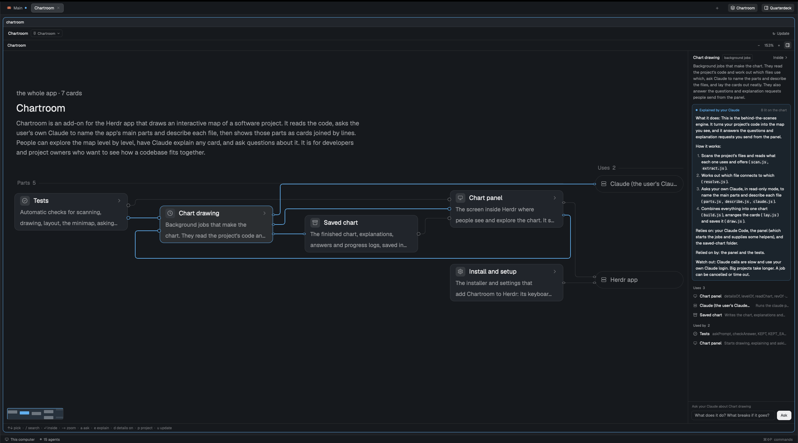

# Chartroom

[](https://github.com/PieterLuypaert/chartroom/actions/workflows/test.yml)

An interactive map of your codebase in the [Herdr app](https://herdr.dev), drawn by your own Claude.

The Chartroom reads a project, asks `claude` to name its parts and describe every file, and shows the result as a chart you can explore: the app's parts as cards, what uses what as lines, one level at a time.



Go inside a part to see its files:


## Features

- **Explore**: each level in three bands (what uses a part, what is inside it, what it uses). Double-click a card to go inside, scroll to zoom, drag or use the minimap to move.
- **Find**: press `/` and type a part's or file's name, a path or a route such as `GET /orders`, and go straight to its card.
- **Explain and ask**: have Claude explain any card, or ask it about a card or level and see the cards in its answer lit on the chart.
- **Stay current**: an update re-describes only the files that changed, and keeps the explanations of the rest.
- **Fits in**: follows the focused space or any project you pick, in your Herdr theme's colors.

## Install

Needs the Herdr app, [Bun](https://bun.sh), `git`, `jq` and the Claude Code CLI, logged in.

```sh
git clone https://github.com/PieterLuypaert/chartroom.git
cd chartroom
./install.sh
```

This links the mod, binds its keys and adds a **Chartroom** button to your layout's tab bar. Herdr replaces its built-in layouts on every start, so use one of your own: `install.sh` tells you how. After pulling, run `./install.sh` again and restart Herdr.

## Usage

Click **Chartroom** or press `⌥⌘F`; `⌥⇧⌘F` opens it as a side panel. In a project without a chart, click **Draw the chart**.

`↑` `↓` pick · `↵` `⌫` in and up · `/` find · `e` explain · `a` ask · `d` details · `−` `+` `0` zoom · `u` update · `p` project

## How it works

The code is scanned without Claude: imports through TypeScript, Python, Go, PHP, Java, Kotlin and Rust, and web requests matched to their endpoints. One read-only `claude -p` call then names the app's parts, and files are described in batches on a faster model. The chart is written to `.chartroom/` in the project, kept out of git.

Everything runs locally, on your own Claude subscription. Claude only gets tools that read: it never changes your code.

## Development

```sh
bun test                          # unit and end-to-end tests, no Claude or Herdr needed
herdr-app check mods/chartroom    # load the mod once
bun draw/draw.js <folder>         # draw a chart from the command line
```

`draw/` holds the drawing, `mods/chartroom/` the panel. [RECIPE.md](RECIPE.md) describes the Chartroom for an agent to build from an empty folder.

## License

[MIT](LICENSE)
