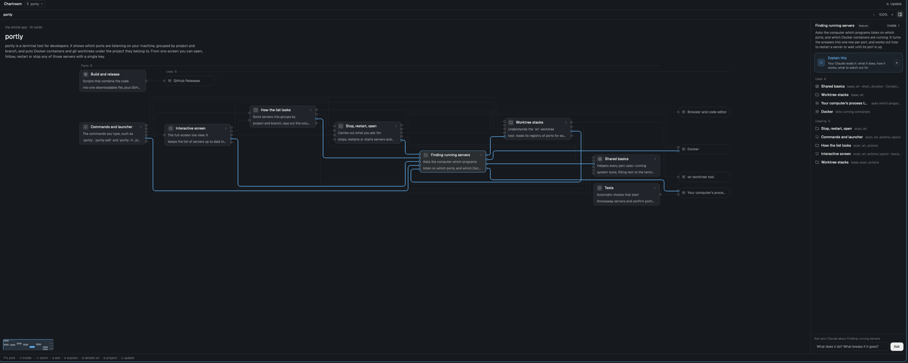
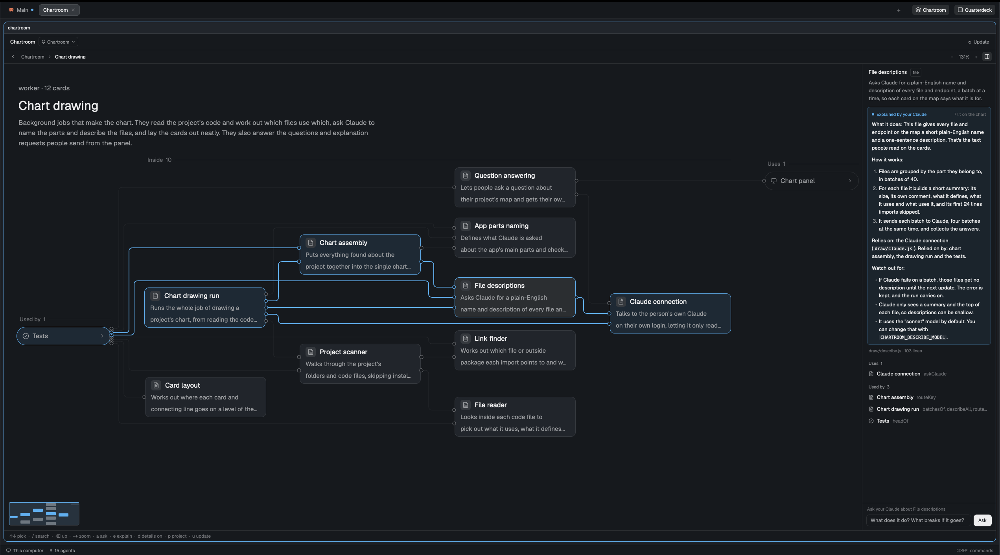

# Chartroom

An interactive map of a project's code, drawn and explained by the person's own Claude. Claude names the
app's parts and describes every file; the chart shows one level at a time, as cards joined by lines for what
uses what. Claude explains any card and answers questions about a card or a level, lighting the cards it
names. It only reads the code, on the person's own Claude subscription. A **Chartroom** button in the tab bar
opens it.

## What you see

Everything sits on `t.chrome`, with 13px `t.foreground` text and 1px `t.border` rules. Top to bottom:

- **Header, 42px** (16px left, 8px right padding): "Chartroom" in semibold, then the project button (24px
  high, at most 220px wide, 1px `t.border` frame, `t.accent` while the picker is open, 11.5px `t.muted`; a
  pin icon when the project was picked rather than followed, the chart's name, a chevron-down). Then a
  spacer, a 13px spinner while the chart is read again, and **↻ Update** (26px, 12px `t.muted`; `t.accent`
  with a 1px accent frame when the code has moved on). In the side panel only, two 26px icon buttons
  follow: **full size** (square) and **close** (x).
- **Trail, 34px** (12px): a back chevron below the top level, then crumbs from the app's name down,
  between 11px `t.dim` chevrons. Earlier crumbs are `t.muted`, at most 120px wide and clickable; the current
  one is medium `t.foreground`. On the right: zoom controls `−` `NN%` `+` (22px, 12px, only with ELK's
  layout) and a 24px details toggle (`t.selected` while the details show; panel-right icon in a wide view,
  panel-left in a narrow one).
- **Strips, when they apply.** During an update: 34px, a `t.working` spinner, "Updating · Describing every
  file: 120 of 300 files" and **Stop**. When the code has moved on: 36px, a 7px `t.accent` dot, "The code
  moved on since this chart: 2 commits, 3 files not committed" and a solid **Update the chart** (`t.solid`,
  `t.solid_foreground` text). Errors: one 12px `t.blocked` line, such as "The last drawing failed: …".
- **Body**: the chart and the details. From 900px wide, the details sit on the right (340px, left border);
  narrower, under the chart (36% of the height, kept between 150px and 300px, top border). Folded, the chart
  gets the whole width.
- **Status bar, 28px** (11.8px `t.dim`, top border): only the keys that work now, joined by "  ·  ", such
  as "↑↓ pick · / search · ↵ inside · ⌫ up · −+ zoom · a ask · e explain · d details on · p project · u update".

**The chart** reads left to right (three bands side by side) when the chart area is at least 860px wide,
top to bottom when narrower. In a wide view a heading sits over the cards and moves with them: the level's
kind and card count in 12px `t.dim` ("the whole app · 7 cards", "service · 12 cards"), the name in 24px
semibold, the summary in 13px `t.muted` (under 700px tall: 19px name, 12px summary cut at two lines). Each
band has a label pill in 11px medium `t.dim` on `t.chrome` ("Used by  2", "Parts  6" at the top or
"Inside  6" below it, "Uses  3") over a 1px `t.border` rule.

Card sizes at 100%: left to right, inside 236×78 and outside 184×36; top to bottom, 188×50 and 160×32.
Outside services always take the outside size. **Inside cards**: 9px radius, `t.background` fill, 1px
`t.border` frame, a 20px `t.raised` tile with a 12px kind icon, the name in 13px semibold, and a chevron
when the card opens. Left to right, two 11.8px `t.muted` lines say what it does; top to bottom, one 11px
`t.dim` line says what it is ("server · 14 files", or a file's folder and "2 endpoints"). A file card left
to right has one line plus a route chip: the method on `t.accent` at alpha `26`, the path in JetBrains
Mono, "+N" for more. **Outside cards** are pills on `t.chrome` with an icon and a 12.5px `t.muted` name.

Kinds, as word / icon from `mods/workspace-chrome`: ui app / monitor; service server / terminal; worker
background jobs / clock; feature feature / folder; library shared code / layers; data data / archive; config
setup / settings; test tests / circle-check; external outside service / server; file file / file-text; misc
other / folder.

The picked card has a `t.selected` fill and a `t.accent` frame; a card an answer names gets `t.accent` at
alpha `1c` and an accent frame. **Lines** are 1.2px `t.dim` at alpha `b0` (`60` while something is picked
or hovered; on a level with more than 18 lines, `4a` and `26`). A hovered card's lines are `t.accent` at
alpha `90`; the picked card's are 1.8px `t.accent`. Corners round at 9px, and each end has a small ring
(radius 3.2 × zoom, at least 2.4). Until the layout arrives: "Laying the chart out…" with a spinner; an
empty level: "Nothing on this level."

**Minimap**: in the chart's bottom-left corner (left 12, bottom 12), at most 180×120 and at least 36 a
side, 6px radius, a `t.border` frame on `t.background`. Cards are blocks: `t.accent` when picked or lit,
`t.dim` inside the level, `t.border` outside it. The part in view: a `t.accent` frame on accent at alpha `18`.

**Details.** With no card picked: the level's name, a pill ("6 parts · 4 files"), its summary, and "Pick a
card to see what it uses and what uses it. Double-click one with › to go inside." With a card picked: its
name, a pill with its kind word, **Inside ›** when it opens, and its summary. Then **Explain this** (10px
radius, accent frame at alpha `55` on accent at alpha `10`, a search icon, "Your Claude reads it: what it
does, how it works, what to watch out for", an `e` keycap); once asked, an 8px box with a 6px accent dot,
"Explained by your Claude", "N lit on the chart" and the Markdown text. For a file: its path, line count and
routes. Then "Uses  N" and "Used by  N", one 28px row per card: icon, name, what the link carries ("3
links" when nothing is named). Then "Asked  N", at most 8 answer cards (8px radius, `t.background`, accent
frame while lit): the question in 12.5px medium, then the answer in Markdown, "Your Claude is reading the
code…" with **Stop**, or "No answer: …" in `t.blocked`; a finished answer that names cards adds "3 on the
chart: click to light them". At the foot: "Ask your Claude about <card or level>", a 30px field (accent
frame while typing; placeholder "What does it do? What breaks if it goes?") and a solid **Ask** button.

**Tab bar button** (a 108px block): 26px high, 6px radius, a 14px layers icon and "Chartroom" in 12px;
`t.muted` on `t.chrome`, or `t.foreground` on `t.selected` while the space shows its Chartroom tab.

## How it behaves

- **Opening.** The button or ⌥⌘F opens the space's Chartroom tab full size: it selects the tab when there
  is one, else opens a new "Chartroom" tab on the space's project. Pressed again from that tab, it goes back
  to the tab you came from. ⌥⇧⌘F shows or hides the side panel. In the panel, `f` opens full size on the
  same level and card; × (or `esc` at the top level) closes it and gives the keyboard back to the pane
  that had it.
- **Which project.** It follows the focused pane's folder in the active space. The project button or `p`
  swaps the chart for a picker: "Follow the focused space"; each space's project with a badge (a spinner
  while checking, then "chart", "no chart" or "not reached"); and "Choose a folder…" (the system folder
  picker; the last 8 chosen are kept). `↑↓` moves, `↵` charts the row, `esc` or `p` goes back. A picked
  project shows a pin and stays picked after a restart. The chart lives in `.chartroom/` of the folder or the
  nearest folder above it, short of home.
- **No chart yet.** "No chart of <name> yet", a paragraph on what drawing does, a solid **Draw the chart**
  and **Pick another project**. After a failed drawing the button reads **Try again**, with the reason in
  `t.blocked`. With no folder: "No folder to chart: focus a terminal in a project, or pick one (p)."; while
  looking: "Looking for a chart…".
- **Drawing.** A first drawing shows a centered card, at most 520px wide: "Drawing the chart of <name>", a
  40px accent-tinted layers tile, **Stop**, a percentage with "running 1 min 12 s", a 6px accent bar, and
  four steps: Reading the code (10%), Finding the app's parts (25%, marked Claude), Describing every file
  (55%, marked Claude, "N of M files"), Drawing the chart (10%). Done steps get an accent check; the current
  one a `t.working` spinner on a `t.background` row. Stopped or failed, the view goes back to "no chart yet"
  with the reason. A drawing keeps running after the panel or the app closes.
- **Chart behind the code.** Every 30s while open, git counts the commits past each repo's charted head
  and the uncommitted files changed after `chart.json` was written. Above zero, Update lights up and the
  strip shows. `u` updates, describing only the files that changed.
- **Moving around.** Click a card to pick it: its lines light and fade in; hovering lights a card's lines
  too; arrow keys step through the cards in reading order. Double-click or `↵` goes inside a card that
  opens, and the new level fades in. `⌫`, `esc`, the back chevron or a crumb goes up, with the part you came
  from picked. A press that moves 4px drags the chart (the release is no click); it moves freely as long as
  120px stays in view. The wheel or two fingers zoom around the pointer (60% to 160%); with shift or ⌘ they
  pan. `−`/`+` zoom by 1.2×; `0` or a click on the % fits the width (at most 100%, at least 75%, so a wide
  chart then scrolls sideways). On a resize, zoom or fold, cards glide in 220ms and the lines hide until
  they arrive; wheel zoom follows at once.
- **Minimap.** Only with ELK's layout and a chart area of at least 360×260. A click moves the view's middle
  there; dragging the frame drags the view without a jump. While the pointer is on it, no card lights.
- **Search.** `/` swaps the chart for a search: a 32px field (8px radius, `t.accent` frame, a search icon,
  placeholder "Find a part, file or endpoint"), then at most 20 rows (30px, 7px radius, `t.selected` under the
  cursor): the kind's icon, the name, an endpoint's route chip, and in 11.5px `t.dim` where the card sits
  ("Server › Orders", or the app's name at the top). Every word typed must be in a card's name, its path or
  route, or what it does; names that start with the query come first, then names that hold it, then paths and
  routes, then the rest, parts before files, shorter names first. `↑↓` moves, `↵` or a click goes to the
  card's level with it picked, its lines lit and its details shown (an endpoint goes to its file), and `esc`
  goes back. Before typing: "A part's or file's name, a folder or file path, or a route such as GET /orders.";
  with nothing found: "Nothing on the chart matches." `/` is read by the character typed, so on AZERTY it
  works with shift. It needs no Claude, so it works on a remote project too.
- **Explain.** Picking a card shows its kept explanation at once if the card has not changed since, else
  **Explain this**. That button or `e` has Claude explain the card in the background (about 120 words); the
  cards it names light up. Explanations are kept per card until its code or links change: an update that
  leaves a card alone leaves its explanation.
- **Ask.** `a` focuses the field, `↵` or **Ask** sends, `esc` leaves the field. Answers are listed per card
  (a picked card lists only the questions about it, from any level) and per level (with nothing picked,
  only that level's own). Clicking a finished answer lights the cards it names; again turns them off.
  **Stop** ends one still running.
- **Details.** `d` folds them away or back, remembered. Picking a new card with the mouse unfolds them.
- **Remote project** (a space on another machine): the chart is read there every 15s (no folder watch) and
  the changed check runs there too. Drawing, asking and explaining are off ("Drawing a chart needs the
  project on this computer.", "Asking about a chart needs the project on this computer.").
- The last 8 places shown come back at the level and card they were left on.

## Built from

- **The share folder is the whole repo**: `mods/chartroom/`, `draw/`, `keys.json`, `install.sh`,
  `layout.jq`, `package.json` (dependency `elkjs` 0.9.3) and `bun.lock`.
- `mods/chartroom/mod.json`: `{ "place": "none", "title": "Chartroom", "focusable": true }`.
- `main.js`: the view (header, trail, strips, body, status bar, picker, ask, explain, zoom, pan, keys), in
  three `props` roles. `{button: true}` is the tab bar button: it draws only the button, takes no keys (on
  `"focus"` from `nextCommand()` it runs `pane.go {direction: "down"}`), and is the only copy that acts on
  the command `full` / `chartroom.full`. `{tab: true, project, focus, selected}` is the full-size tab. No
  props is the side panel (block id `chartroom`).
- `model.js` reads `.chartroom/chart.json`, schema `chartroom/chart@1`: `meta` {generatedAt, root, repos
  [{path, head}]}, `project` {name, summary}, `nodes` [{id, parent, label, kind, summary, stats, rev}], `files`
  [{p, n, loc, name, d, rev}], `routes` [{f, m, p, name}], `links` [{a, b, w, labels}]; refs are `n:<id>`,
  `f:<path>`, `r:<index>`. `levelOf(chart, focus)` gives the inside cards (child parts plus the focus's own
  files), the outside cards linked to them (`side` "above" when they only use the level, else "below"), and
  one line per pair and direction with a weight and labels.
- `layout.js`: `elkLevel` (bands 0/1/2, card sizes per direction) and `fromElk` (zoom, centering, band
  labels); `layOut` is the plain fallback (rows of 132–240 × 52px cards, curved lines with arrowheads).
- `chart.js`: `chartView` (cards; lines as `PathBuilder` paths through `window.paint_path`; port rings;
  bands), `minimapView`, `detailsView` (details, explanation, answers, ask bar; `TextView.markdown`,
  `Input`), `searchView`. `minimap.js`: `minimapOf`, `panAt`, `grabOf`, `hasRoomFor`. `drawing.js`: the
  first-drawing card, update strip, changed strip, `endedWords`. `projects.js`: picker rows and badges.
  `search.js`: `searchIndexOf(chart)` (every part, outside service, file and endpoint with its level and
  lowercased words, made once per chart when the search opens) and `searchChart(index, query)` (the best
  20, kept while looking rather than sorting every match).
- `find.js`: shell snippets run as `exec("sh", ["-c", SNIPPET, name, ...args], { on })`. `FIND_MAP` (chart,
  progress, log tail, whether a drawing runs), `FIND_CHARTS` (which folders have a chart), `START_DRAW` /
  `STOP_DRAW` (`nohup bun draw.js <folder> [--update]`, and kill), `START_ASK` / `STOP_ASK` / `FIND_ASKS` /
  `FIND_EXPLAIN`, and `CHANGED` (commits past the charted heads, uncommitted files newer than the chart).
- From `"herdr"`: `appHome, exec, focused, home, layout, nextCommand, notify, panes, pickFolder, props, run,
  settings, spaces, theme, watchFolder`. Commands: `tab.new {space, name: "Chartroom", mod: "chartroom",
  props}`, `tab.select`, `layout.hide {id: "chartroom"}`, `pane.focus`, `pane.go`.
  `watchFolder(<folder>/.chartroom)` reads again on changes to `chart.json`, `progress.json` or `pid`.
  `localStorage`, one per copy, keeps `pinned`, `picked` and `detailsFolded`.
- Programs: `sh`, `bun`, `git`, `ps`, `kill`, `claude`. The `draw/` pipeline, `bun draw/draw.js <folder>
  [--update]`: **scan** (no Claude; `git ls-files`, imports resolved for JS/TS, Python, Go, PHP, Java,
  Kotlin and Rust, web requests matched to the endpoints that answer them), **parts** (one `claude -p` with Read,
  Grep, Glob), **describe** (batches of 40 files, 4 at once, no tools, model `sonnet` or
  `$CHARTROOM_DESCRIBE_MODEL`),
  **build**. It writes `.chartroom/{chart,state,progress}.json`, `pid`, `draw.log` and a `.gitignore` of `*`.
  `claude.js` runs `claude -p --output-format json --no-session-persistence --strict-mcp-config
  --setting-sources "" --tools … --json-schema …`. `ask.js <folder> <id> <json>` writes
  `.chartroom/asks/<id>.json` (or `explains/<hash>.json` for an explanation, model `sonnet`), status asking
  then done, failed or stopped, with `answer`, up to 8 `cards` and the card's `rev`. `lay.js '<levels json>'` runs ELK
  (layered, partitioned by band, orthogonal edges, fixed-side ports) and prints `{layouts}`.
- `keys.json`: `"global": { "cmd-alt-f": "chartroom.full", "cmd-alt-shift-f": "layout.toggle:chartroom" }`.
- `install.sh [layout]` needs `jq`, `bun` and `herdr-app`. It symlinks `~/.config/herdr-app/mods/chartroom`
  to the checkout's `mods/chartroom`, runs `bun install --frozen-lockfile`, merges the keys (free keys
  added, keys still on `chartroom.*` or `layout.toggle:chartroom` moved, any other binding left alone, the
  old file kept as a backup), runs `layout.jq` on the shown layout (or the one named), and ends with
  `herdr-app check`. `layout.jq` needs a row root. It appends the panel `{id: "chartroom", hidden: true,
  size: {px: 460}, min: 340, max: 600, content: {mod: "chartroom"}}`, and wraps the `tabs` block in a
  `tabs-row` row (not resizable): the tabs at weight 1, then `{id: "chartroom-button", size: {px: 108},
  window_drag: true, content: {mod: "chartroom", props: {button: true}}}`. Where the Quarterdeck's panel or
  button is there already, each goes just before it.

## Watch out

- **The mod alone does not work.** `script()` finds the checkout with `pwd -P` of
  `<appHome>/mods/chartroom` and runs `<checkout>/draw/*.js` with `bun`, so the mod folder must be a
  symlink into the checkout, as `install.sh` makes it. `draw/ask.js` also imports `model.js` and `find.js`
  from the mod.
- Herdr does not hot-reload a mod through that symlink: restart the app after changing or switching the
  checkout.
- Herdr replaces its own layouts (main, terminals, win98; `layout:<name>` in `installed.json`) on every
  start. `install.sh` refuses them and prints the `layout.clone` command to run first.
- Only the button copy acts on `chartroom.full`: a layout without a `tabs` block gets the panel and no
  button, and ⌥⌘F does nothing there (`f` in the panel still opens full size).
- Icons come from `mods/workspace-chrome/*.svg`: the app draws no asset reached through the symlink.
- Colors come only from `theme()` names, so it follows any theme, light or dark. Accent tints append an
  alpha to `#rrggbb`; an accent that already has an alpha makes those fills solid.
- `on_size_change` sizes are in app-zoomed units: divide by `settings().zoom`.
- Herdr runs mods on QuickJS and interrupts a render that takes longer than about 50 ms ("This view could not
  be re-rendered"). On a 6000-file chart with 26,000 links, a level works out each card once (`levelOf`), the
  search index is made when the search opens, and a key typed only searches it.
- `exec` returns at most 8 MiB (`MAX_OUTPUT`): a bigger chart fails with a message saying so. `lay.js` gets
  its levels as an argument, kept under 400 KiB (`MAX_LAY_ARG`), else the plain layout. Up to 12 levels one
  click away are laid out ahead, each under 100 KiB. Without `elkjs`, every level gets the plain layout, with
  a note saying why.
- Polls: the chart is read again every 15s (`READ_MS`) while remote, chartless, drawing or failed; the
  changed check every 30s; answers and explanations every 1.5s while they run. Limits: 6000 files of at most
  400 KiB in a scan; a 15-minute timeout and one retry per Claude call; answers: `ask.js` keeps
  the newest 8 per card and per level, 200 in all, and the panel reads 200 and shows 8.
- A drawing runs detached and its `pid` file is the lock. It counts as running only while that pid lives and
  `ps` shows `draw/draw.js`, so a stale pid is never taken for one. The home folder is refused. `bun` must
  be on the PATH the Herdr app runs programs with.
- `localStorage` is per copy: a new tab starts without a pin and charts its `project` prop, while a copy
  pinned before keeps its pin over the prop.
- `herdr-app check` writes `gpui-kit.d.ts` and `jsconfig.json` into the mod folder; keep them out of git.

## Done when

- `bun test` passes, and `herdr-app check ~/.config/herdr-app/mods/chartroom` loads the mod.
- The mod folder is a symlink to the checkout and `keys.json` binds ⌥⌘F and ⌥⇧⌘F; a second `install.sh`
  leaves `keys.json` and the layout as they were.
- The button sits at the right end of the tab bar. A click opens a "Chartroom" tab and lights the button;
  another goes back to the tab before. ⌥⇧⌘F shows the 460px panel; `esc` hides it.
- In a project without a chart, **Draw the chart** shows the four steps with a rising percentage, then
  `.chartroom/chart.json` appears with `"schema":"chartroom/chart@1"` next to a `.gitignore` of `*`.
- The top level shows "Used by", "Parts" and "Uses" bands joined by right-angled lines. Double-clicking a
  card with a chevron goes inside; the trail and `⌫` go back up.
- The wheel zooms around the pointer and the % label follows; `0` fits. The minimap sits in the bottom-left
  corner, and dragging its frame moves the view without a jump.
- `e` on a card shows "Explained by your Claude", then the text. Picking another card and coming back shows
  it again without asking, and so does an update that changed a file in another part.
- A question asked with a card picked is listed only on that card; with nothing picked, only that level's
  questions show. Clicking an answer lights its cards.
- After a commit, the "The code moved on since this chart" strip appears within 30s, and **Update the
  chart** starts an update.
- `/`, part of a file's name and `↵` show that file picked on its part's level with its lines lit; a route
  such as `GET /ports` finds the file that answers it.
- The picker lists every space's project with a "chart" or "no chart" badge. Switching between a light and
  a dark theme recolors everything.
